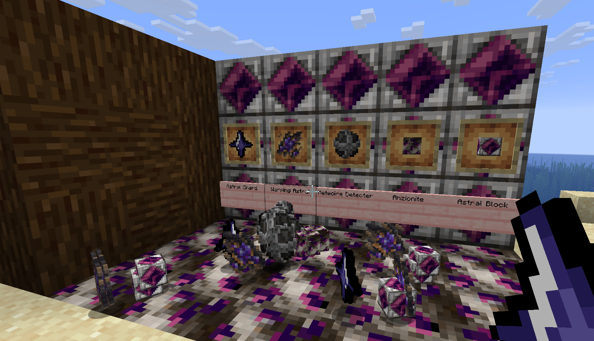

## Shizees Mod

An Alien/Cosmic themed minecraft mod made for neoforge **26.2** which adds custom items/blocks/ores which has some lore behind it!  



## To play the Mod 
* download the jar file from the  github release.
* make sure the version is same and not different.
* make sure it is Neoforge and not Forge.

## Features Included in the Mod 
## Items 

* Warping Astral
* the warping Astral has a unique mechanic that i implemented regarding its lore which involves around the darkness of the **Cosmos**.
* When the sun's light gets radiated on  the warping astral, It begins to shake violently and teleports to its **mothership**.

* Astral Shard
* a stabalized core material acquired by smelting The Anzionite.
* designed to create heavy power transmuting crystallized blocks.

* Meteoite Detecter
* A unique ball made to scan rare ores and specially the meteorite which fell onto the world by **unknown reasons**.
* **it looks good**

## Ingredients 
* Dough
A bad edible base ingredient used to make tasty foods

* Strawberry
* Chocolate
* Avocado

## Foods

| Food | Effects |
|---|---|
Donut | Speed 1,20s
Croissant | none
Croissant SandWich | Regeneration 1
Croissant Avocado Sandwich | Regeneration1 + Resistance 1
Danish Glazed | Haste 1
Danish Glazed2 | Haste 2
Strawberry Shortcake | Regeneration 1 + absorption 2
ChocolateBerry Shortcake | Speed 1 + Absorption 2

## Recipes

| Item | Type | Recipe |
|---|---|---|
| Dough | shapeless | 3 wheat + 1 egg + 1 Milk bucket |
| Chocolate | Shapeless | 2 Cocoa Beans + 1 Sugar + 1 Milk Bucket |
| Strawberry | Shapeless | 1 Sweet Berries + 1 Wheat Seed |
| Avocado | Shapeless | 1 Apple + 1 Emerald [heh] |
| Croissant | Furnace | Smelt 1 Dough |
| Croissant Sandwich | Shapeless | Croissant + Cooked Porkchop + Egg |
| Croissant Avocado Sandwich | Shapeless | Croissant + Avocado + Egg |
| Danish Glazed | Shapeless | Dough + Honey Bottle + Sugar |
| Danish Glazed 2 | Shapeless | Danish Glazed + Strawberry |
| Strawberry Shortcake | Shapeless | Dough + 2 Strawberry + Sugar + Egg |
| Chocolate Berry Shortcake | Shapeless | Dough + Chocolate + Strawberry + Sweet Berries + Sugar |
| Donut (makes 2) | Shaped | See the grid below |

**Donut crafting grid** (S = Sugar, D = Dough):

```
_ S _
D _ D
_ D _
```
And milk buckets and honey bottles do give back empty bucket and glass bottle 

## Creative Tab
All da foods and ingredients are in the **Food Creative Tab**, so u can find everything in one place.


## Blocks 
* Anzionite Ore
* A meteorite which fell from unknown origins embedded deep into the world.
* When mining it gives **Warping Astral**

* Astral Block
* A very high Energy densed Block made with the hightly stabalized Astral shard causing it to destabalize.

## Teck Stack 
* Java : JDK 25
* Mod Loader : Neoforge 1.21+
* IDE : Intellij IDEA 


## compatibility with Just enough Items (JEI)
